# E-Wallet Application

Aplikasi E-Wallet berbasis ASP.NET Core yang menyediakan fitur pengelolaan pengguna, wallet, top up, transfer saldo, dan riwayat transaksi.

Project ini terdiri dari dua bagian utama:
- **RESTful Web API** sebagai backend untuk mengelola data dan business logic.
- **ASP.NET Core MVC (Razor View)** sebagai frontend untuk berinteraksi dengan pengguna.

## 1. Teknologi yang Digunakan

| Teknologi | Kegunaan |
|---|---|
| C# | Bahasa pemrograman |
| ASP.NET Core Web API | Backend API |
| ASP.NET Core MVC | Frontend aplikasi |
| Razor View | Tampilan halaman |
| SQL Server | Database |
| ADO.NET | Komunikasi dengan database |
| Repository Pattern | Pengelolaan akses data |
| DTO | Transfer data antar layer |
| Tailwind CSS | Styling antarmuka |
| Scalar | Dokumentasi dan pengujian API |

## 2. Fitur Aplikasi

- Menampilkan daftar pengguna.
- Menampilkan informasi wallet dan saldo.
- Melihat detail wallet.
- Melakukan top up saldo.
- Melakukan transfer saldo antar-wallet.
- Melihat riwayat transaksi.
- Menghitung total pendapatan dan pengeluaran.
- Mengelola data pengguna (Create, Read, Update, Delete).

## 3. Struktur Project

Struktur project secara umum:

```text
Ewallet/
│
├── Ewallet.Api/
│   ├── Controllers/
│   │   ├── UsersController.cs
│   │   ├── WalletsController.cs
│   │   └── TransactionsController.cs
│   │
│   ├── Models/
│   │   ├── User.cs
│   │   ├── Wallet.cs
│   │   └── Transaction.cs
│   │
│   ├── DTOs/
│   │   ├── UserRequest.cs
│   │   ├── UserResponse.cs
│   │   └── TransactionResponse.cs
│   │
│   ├── Repositories/
│   │   ├── IUserRepository.cs
│   │   ├── UserRepository.cs
│   │   ├── IWalletRepository.cs
│   │   ├── WalletRepository.cs
│   │   ├── ITransactionRepository.cs
│   │   └── TransactionRepository.cs
│   │
│   ├── Services/
│   │   ├── IUserServices.cs
│   │   ├── UserServices.cs
│   │   ├── IWalletServices.cs
│   │   ├── WalletServices.cs
│   │   ├── ITransactionServices.cs
│   │   └── TransactionServices.cs
│   │
│   ├── Data/
│   ├── Program.cs
│   └── appsettings.json
│
├── Ewallet.Mvc/
│   ├── Controllers/
│   │   ├── HomeController.cs
│   │   └── WalletPageController.cs
│   │
│   ├── ViewModels/
│   ├── Views/
│   │   ├── Home/
│   │   ├── WalletPage/
│   │   └── Shared/
│   │
│   ├── wwwroot/
│   ├── Program.cs
│   └── appsettings.json
│
└── README.md
```

## 4. Entity Relationship Diagram (ERD)

Database menggunakan tiga tabel utama, yaitu Users, Wallets, dan Transactions.

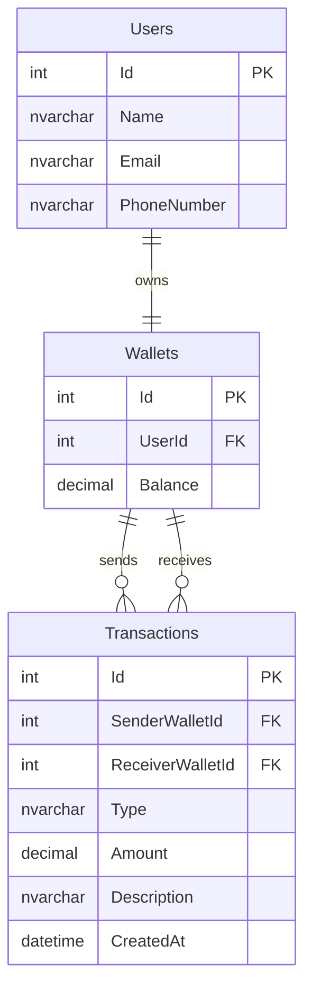

### Relasi Database

- **Users - Wallets:** Setiap pengguna memiliki wallet.
- **Wallets - Transactions (Sender):** Wallet dapat menjadi pengirim transaksi.
- **Wallets - Transactions (Receiver):** Wallet dapat menjadi penerima transaksi.

`SenderWalletId` dapat bernilai NULL untuk transaksi top up, sedangkan `ReceiverWalletId` menunjukkan wallet penerima saldo.

## 5. Alur Sistem

### A. Alur Web API

Web API bertanggung jawab menangani request, business logic, dan komunikasi dengan database.

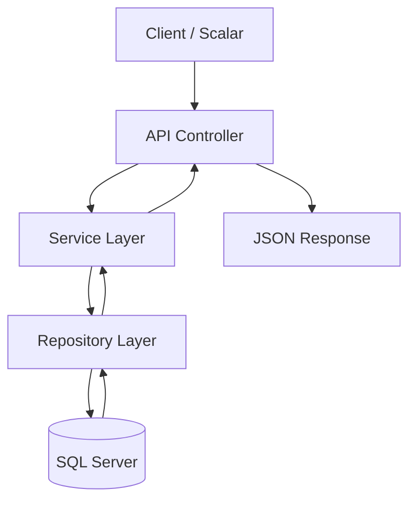

Penjelasan:

1. Client mengirimkan HTTP Request ke endpoint API.
2. Controller menerima request dan memanggil Service.
3. Service menjalankan business logic dan validasi.
4. Repository menangani query database.
5. Database mengembalikan hasil query.
6. API mengirimkan response dalam format JSON.

### B. Alur MVC

MVC bertanggung jawab menampilkan halaman dan menghubungkan interaksi pengguna dengan Web API.

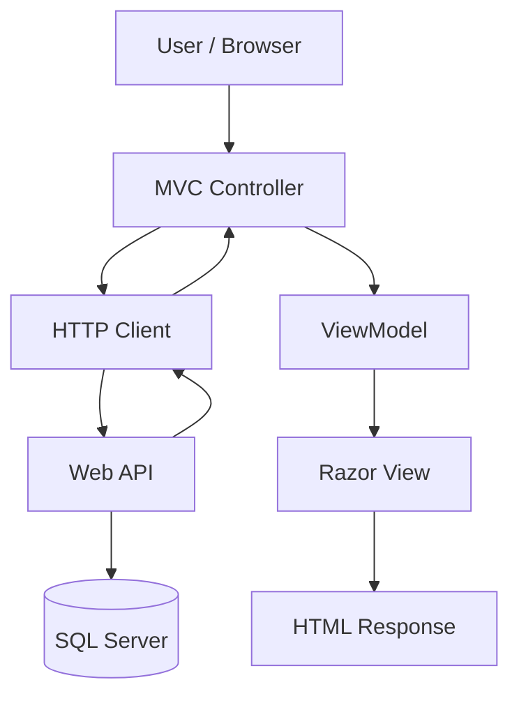

Penjelasan:

1. Pengguna mengakses halaman melalui browser.
2. MVC Controller menerima request.
3. Controller mengirim HTTP Request ke Web API.
4. API memproses request dan mengembalikan JSON.
5. MVC mengolah response menjadi ViewModel.
6. Razor View menampilkan data kepada pengguna.

## 6. Daftar Endpoint API

Base URL:

```text
https://localhost:<API_PORT>
```

### Users

| Method | Endpoint | Deskripsi |
|---|---|---|
| GET | `/api/users` | Menampilkan semua pengguna |
| GET | `/api/users/{id}` | Mengambil detail pengguna |
| POST | `/api/users` | Menambahkan pengguna |
| PUT | `/api/users/{id}` | Mengubah data pengguna |

### Wallets

| Method | Endpoint | Deskripsi |
|---|---|---|
| GET | `/api/wallets/{id}` | Mengambil detail wallet |

### Transactions

| Method | Endpoint | Deskripsi |
|---|---|---|
| POST | `/api/users/{usersId}/topups` | Melakukan top up |
| POST | `/api/transfers` | Melakukan transfer |


## 7. Cara Menjalankan Project

### Prasyarat

Pastikan sudah menginstal:
- .NET SDK
- SQL Server
- SQL Server Management Studio (SSMS)
- Visual Studio atau Visual Studio Code

### A. Persiapan Database

1. Jalankan SQL Server.
2. Buat database Ewallet.
3. Jalankan script SQL untuk membuat tabel Users, Wallets, dan Transactions.
4. Sesuaikan connection string pada appsettings.json.

Contoh:

```json
{
  "ConnectionStrings": {
    "Ewallet": "Server=YOUR_SERVER;Database=Ewallet;Trusted_Connection=True;TrustServerCertificate=True;"
  }
}
```

### B. Menjalankan Web API

Masuk ke folder API:

```bash
cd Ewallet.Api
```

Restore dependencies:

```bash
dotnet restore
```

Jalankan aplikasi:

```bash
dotnet run
```

Buka Scalar untuk mencoba endpoint:

```text
https://localhost:<API_PORT>/scalar
```

### C. Menjalankan MVC

Buka terminal baru dan masuk ke folder MVC:

```bash
cd Ewallet.Mvc
```

Jalankan aplikasi:

```bash
dotnet run
```

Buka alamat localhost yang muncul pada terminal untuk mengakses aplikasi.


## 8. Hasil Testing

Pengujian dilakukan untuk memastikan setiap fitur berjalan sesuai dengan kebutuhan aplikasi.

| No | Fitur | Skenario Pengujian | Hasil yang Diharapkan |
|---|---|---|---|
| 1 | Users | Menampilkan daftar pengguna | Data pengguna berhasil ditampilkan |
| 2 | Users | Menambahkan pengguna | Data berhasil disimpan |
| 3 | Users | Mengubah data pengguna | Data berhasil diperbarui |
| 4 | Users | Menghapus pengguna | Data berhasil dihapus |
| 5 | Wallet | Melihat detail wallet | Informasi dan saldo ditampilkan |
| 6 | Top Up | Menambahkan saldo | Saldo bertambah |
| 7 | Transfer | Mengirim saldo ke wallet lain | Saldo pengirim berkurang dan penerima bertambah |
| 8 | History | Melihat riwayat transaksi | Riwayat transaksi ditampilkan |
| 9 | Validation | Mengirim nominal tidak valid | Request ditolak dengan pesan error |
| 10 | Validation | Transfer melebihi saldo | Transaksi ditolak |

## 9. Arsitektur dan Design Pattern

Project ini menerapkan beberapa konsep dalam pengembangan aplikasi:

- **MVC Pattern:** Memisahkan Model, View, dan Controller pada sisi frontend.
- **Repository Pattern:** Memisahkan proses akses database dari business logic.
- **Service Layer:** Menangani proses bisnis aplikasi.
- **Dependency Injection:** Mengelola dependency antar-class melalui container ASP.NET Core.
- **DTO (Data Transfer Object):** Mengatur data yang diterima dan dikirim melalui API.
- **Async/Await:** Menjalankan operasi database secara asynchronous.

## 10. Screenshot
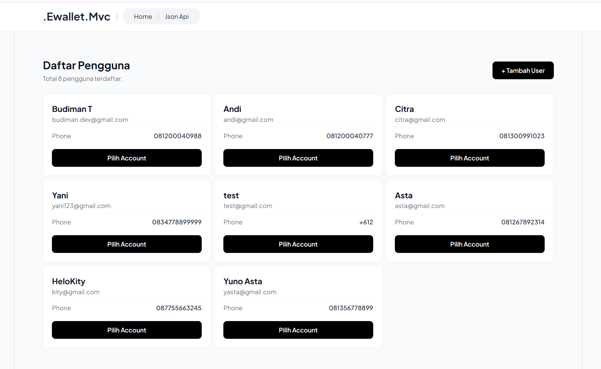
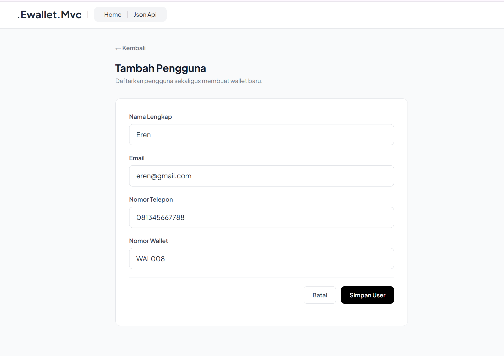
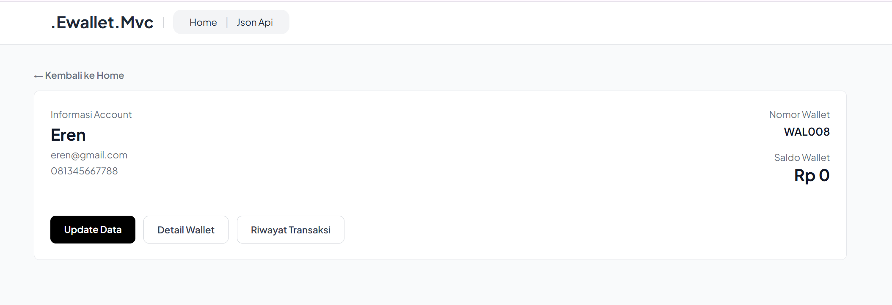
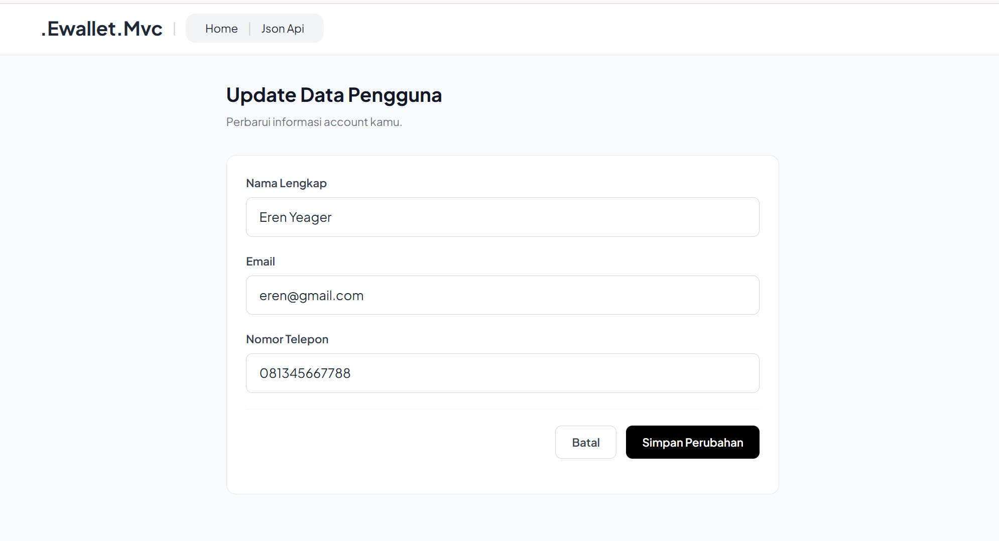
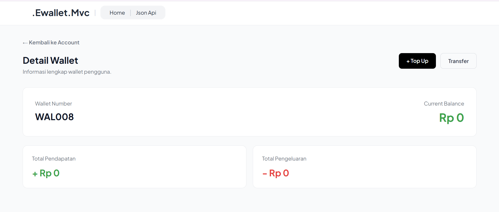
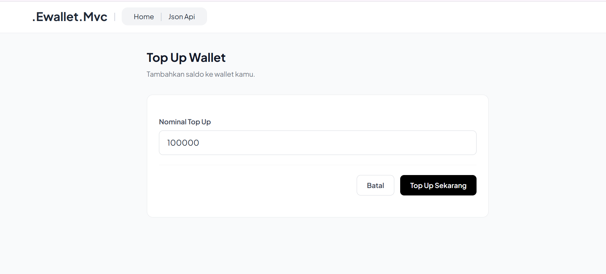
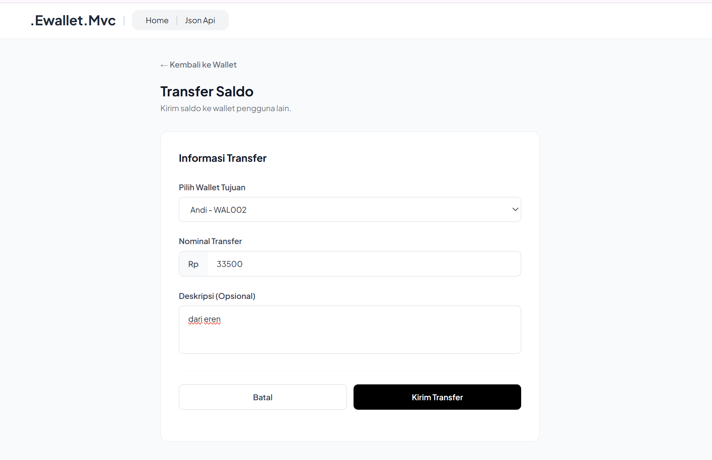
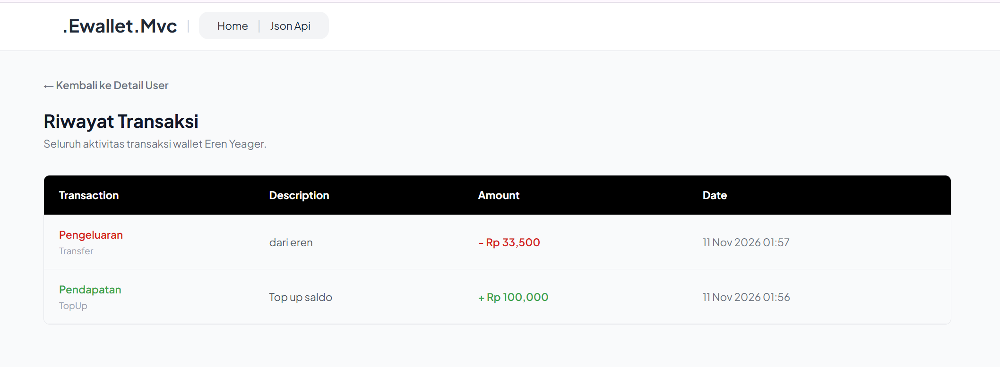
